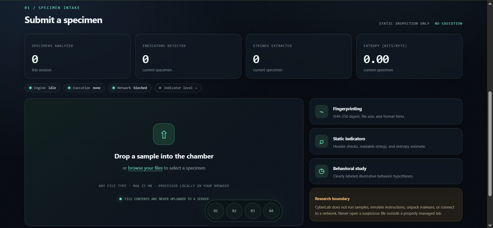
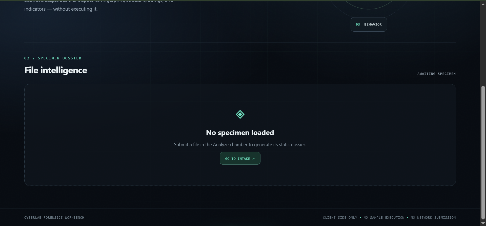
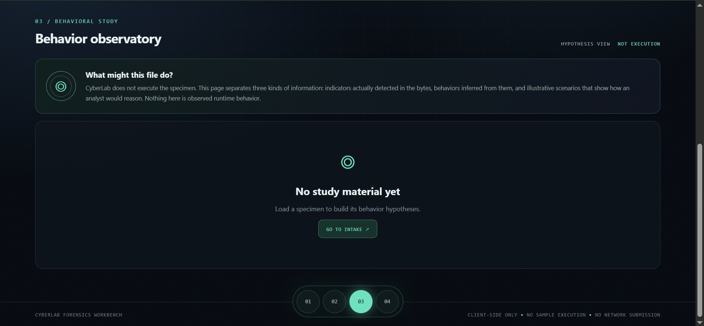
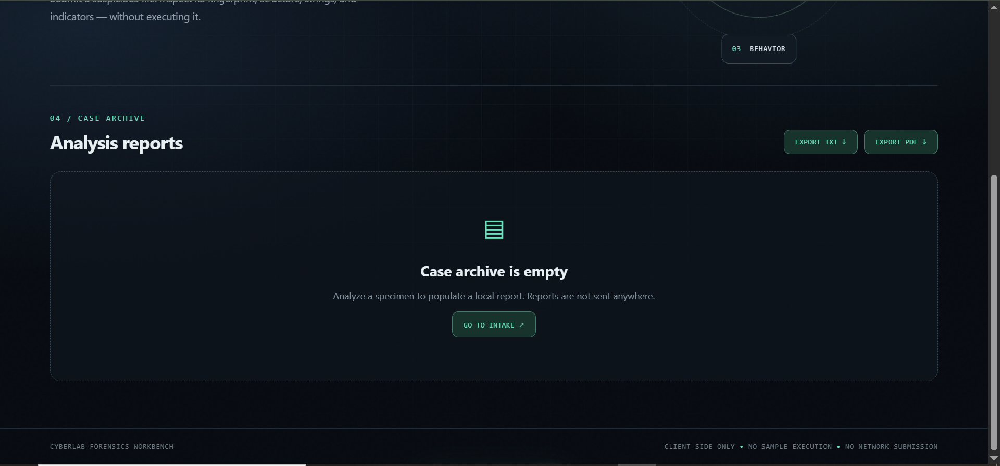

 <div align="center">

# 🔬 CyberLab Forensics Workbench

### Analyze. Investigate. Understand.

A modern, browser-based educational cybersecurity and digital forensics platform designed to help users safely examine suspicious files through static analysis.

<br>


<br>


</div>

---

# 🖥️ Application Preview

CyberLab provides four interconnected workbench sections, each designed for a different stage of the file examination process.

<table>
  <tr>
    <td align="center" width="50%">
      
      <br>
      <b>01. Analyze</b>
      <br>
      <sub>Specimen intake and static file inspection.</sub>
    </td>
    <td align="center" width="50%">
      
      <br>
      <b>02. Specimen</b>
      <br>
      <sub>File intelligence and forensic examination.</sub>
    </td>
  </tr>
  <tr>
    <td align="center" width="50%">
      
      <br>
      <b>03. Behavior</b>
      <br>
      <sub>Behavioral hypotheses and indicator interpretation.</sub>
    </td>
    <td align="center" width="50%">
      
      <br>
      <b>04. Reports</b>
      <br>
      <sub>Analysis summaries and forensic reporting.</sub>
    </td>
  </tr>
</table>

---

# 📌 Overview

Cybersecurity and digital forensics involve examining files, identifying suspicious characteristics, and interpreting technical evidence to better understand potential security threats.

However, examining unfamiliar files can be challenging, especially for students and individuals who are still learning about malware analysis and digital forensics.

**CyberLab Forensics Workbench** was developed to provide an accessible educational environment where users can examine suspicious files without executing them.

The application performs static inspection of uploaded files, allowing users to explore file metadata, cryptographic fingerprints, file signatures, entropy estimates, printable strings, and potentially suspicious indicators.

It also includes a Behavior Observatory that presents possible behavioral hypotheses based on the results of static inspection. An integrated reporting section allows users to review and export their findings.

CyberLab combines technical file inspection with an interactive cybersecurity-inspired interface to make digital forensics easier to explore and understand.

**Its central principle is simple: examine the file, interpret the evidence, and never execute the specimen.**

---

# ✨ Features

- 🔬 **Static File Analysis** — Examine uploaded files without executing their contents.
- 📂 **File Upload and Specimen Intake** — Import files through drag-and-drop or file browsing.
- 🔐 **SHA-256 Fingerprinting** — Generate cryptographic fingerprints for identifying and comparing specimens.
- 📄 **File Metadata Inspection** — Examine file names, sizes, extensions, and available MIME information.
- 🧩 **File Signature Identification** — Inspect file signatures and identify supported file formats.
- 📊 **Entropy Estimation** — Estimate the randomness of file contents to identify characteristics that may be associated with compression or encryption.
- 🔎 **Printable String Extraction** — Extract readable character sequences from supported file contents.
- 🚩 **Suspicious Indicator Detection** — Identify potentially interesting strings, file characteristics, and other static indicators.
- 🧪 **Specimen Dossier** — Present technical file information and analysis findings in an organized interface.
- 🧠 **Behavior Observatory** — Display potential behavioral hypotheses based on detected static indicators.
- 📈 **Interactive Analysis Presentation** — Explore analysis information through visual indicators, timelines, and interactive components.
- 📝 **Forensic Report Generation** — Organize specimen information and analysis findings into downloadable reports.
- 📋 **Analysis Summary** — Review important findings and potential risk indicators.
- 🎨 **Modern Cybersecurity Interface** — Navigate through a dark, professional workbench with interactive visual elements.
- 🧭 **Radial Navigation System** — Access four numbered sections through a distinctive circular navigation layout.
- 📱 **Responsive Interface** — Adapt the application layout to different screen sizes.

---

# 🧭 Workbench Sections

CyberLab is organized into four primary sections.

## 01. Analyze — Specimen Intake

The Analyze section serves as the starting point of the forensic examination process.

Users can upload suspicious files through the file selection interface or drag-and-drop functionality.

After a specimen is submitted, CyberLab performs supported static inspection and presents relevant file information and analysis indicators.

Its purpose is to provide an organized starting point for examining unfamiliar files.

## 02. Specimen — File Intelligence

The Specimen section presents the technical details gathered during static inspection.

Depending on the file and available analysis results, users can examine:

- File name and extension.
- File size and MIME type.
- Identified file format.
- SHA-256 fingerprint.
- Entropy estimate.
- Extracted printable strings.
- Suspicious keywords and indicators.
- Potentially notable file characteristics.

The section helps users understand the technical evidence associated with an uploaded specimen.

## 03. Behavior — Behavior Observatory

The Behavior section presents possible behavioral interpretations based on detected static indicators.

It organizes relevant information through an illustrative timeline, categorized hypotheses, and explanations.

This section is designed to demonstrate how forensic analysts may interpret suspicious file characteristics.

**Important:** The Behavior Observatory does not execute uploaded files or observe actual runtime behavior. Its events and hypotheses are illustrative interpretations derived from static analysis.

## 04. Reports — Forensic Documentation

The Reports section organizes the available analysis findings into a structured presentation.

Users can review important specimen information, detected indicators, analysis summaries, and other available findings.

Reports provide a convenient way to preserve and review the results of a forensic examination.

---

# 🛠️ Technologies Used

## Frontend Development

- **HTML5** — Provides the structure of the application.
- **CSS3** — Handles the visual design, animations, transitions, and responsive layouts.
- **JavaScript (ES6+)** — Controls application behavior, user interactions, and static analysis operations.

## Browser Technologies

- **Web Crypto API** — Supports cryptographic operations such as SHA-256 fingerprint generation when available.
- **File API** — Allows the application to read uploaded files as local data.
- **Drag and Drop API** — Supports interactive file submission.

## Development Tools

- Visual Studio Code.
- Git.
- GitHub.
- Modern web browsers.
- Node.js, where required for automated testing.

CyberLab is designed as a browser-based application and does not require a dedicated backend for its core static inspection workflow.

---

# 🚀 Installation and Setup

Follow these instructions to download and run CyberLab locally.

## Prerequisites

Before running the project, ensure that you have:

- A modern web browser.
- Visual Studio Code or another code editor.
- Git, if you intend to clone the repository.
- Node.js, if you intend to run the automated tests or local development server.

## 1. Clone the Repository

Replace `your-username` with your GitHub username.

```bash
git clone https://github.com/your-username/CyberLab-Forensics-Workbench.git
```

## 2. Navigate to the Project Folder

```bash
cd CyberLab-Forensics-Workbench
```

## 3. Open the Project in Visual Studio Code

```bash
code .
```

Alternatively, open Visual Studio Code manually and select the project folder.

## 4. Launch the Application

For a basic setup, open:

```text
index.html
```

using a modern web browser.

If browser security restrictions affect certain browser APIs when opening a local file, run a local development server instead.

Using Python:

```bash
python -m http.server 8000
```

Then open the following address:

```text
http://localhost:8000
```

The application should now be accessible through your browser.

---

# 📖 How to Use CyberLab

## 1. Open the Workbench

Launch CyberLab through your browser.

The main interface provides access to its four primary sections:

- 01 — Analyze
- 02 — Specimen
- 03 — Behavior
- 04 — Reports

Use the radial navigation controls to move between sections.

## 2. Upload a Specimen

Navigate to **01 – Analyze**.

Choose a file using the upload button or drag and drop it into the specimen intake area.

The application reads the uploaded file as inert data for static inspection.

## 3. Examine File Information

After uploading a specimen, navigate to **02 – Specimen**.

Review the available technical information, including:

- File metadata.
- File format.
- SHA-256 fingerprint.
- Entropy estimate.
- Printable strings.
- Static indicators.

These findings provide information that may help users understand the characteristics of the specimen.

## 4. Explore Potential Behaviors

Navigate to **03 – Behavior**.

Review the available behavioral hypotheses and illustrative timeline.

Examine the explanations associated with each indicator to understand why a particular characteristic may be considered noteworthy.

Remember that these are interpretations based on static evidence, not observations of an executing program.

## 5. Review and Export Reports

Navigate to **04 – Reports**.

Review the available forensic findings and use the report export functionality to preserve the analysis results.

---

# 🔍 Understanding Static Analysis

Static analysis is the examination of a file without executing it.

CyberLab uses this approach to inspect available file characteristics and identify potentially interesting indicators.

### SHA-256 Fingerprinting

SHA-256 generates a fixed-length cryptographic hash from file contents.

It can be used to identify a particular file and compare specimens.

### File Signatures

File signatures are byte sequences commonly associated with particular file formats.

Examining these signatures can help identify the actual format of a file, even when its extension suggests something different.

### Entropy Estimation

Entropy estimation measures the distribution and randomness of data.

Higher entropy may be associated with encrypted or compressed content, but it is not proof of malicious activity.

### Printable String Extraction

Printable string extraction identifies readable sequences of characters within a file.

These strings may contain useful information, such as URLs, commands, filenames, messages, or other embedded text.

### Suspicious Indicators

CyberLab identifies selected characteristics that may deserve further examination.

Examples include:

- Unusual executable file characteristics.
- Suspicious command-related strings.
- Potentially notable URLs.
- Certain system-related keywords.
- Unusual data characteristics.

An indicator should always be interpreted within the context of the entire specimen.

---

# 🧠 Understanding the Behavior Observatory

The Behavior Observatory is an educational component that demonstrates how static indicators may be interpreted during forensic analysis.

It distinguishes between three types of information:

| Classification | Meaning |
|---|---|
| Detected Static | Information directly identified through file inspection. |
| Inferred | Potential behavior suggested by one or more static indicators. |
| Illustrative | Educational examples used to demonstrate forensic interpretation. |

For example, a string containing a command-related keyword may suggest that the file references a system command.

However, its presence does not prove that the command was executed.

This distinction is important when interpreting forensic findings and avoiding unsupported conclusions.

---

# 🛡️ Security and Safety

CyberLab is designed for educational static file analysis.

**Uploaded specimens are not executed.**

The application is intended to examine files as inert data within the browser.

Its security approach includes:

- No arbitrary execution of uploaded files.
- No automatic execution of scripts or binaries.
- No unrestricted operating-system access.
- No malware emulation or runtime execution.
- No automatic submission of specimens to external analysis services.
- Local browser-based file inspection.
- Treatment of uploaded content as untrusted data.

### Important Limitations

Static analysis cannot determine every possible characteristic or behavior of a file.

The following limitations should be considered:

- A suspicious indicator does not automatically mean a file is malicious.
- A file with high entropy is not necessarily encrypted malware.
- A recognized executable format is not proof of malicious activity.
- Extracted strings may be incomplete or misleading.
- Some file structures may not be recognized.
- Static analysis cannot confirm what a program actually does when executed.
- The absence of detected indicators does not guarantee that a file is safe.

CyberLab is an educational forensic inspection tool, not a replacement for a professionally managed malware analysis laboratory.

---

# ⚙️ Core Modules

CyberLab is organized into several functional modules.

- **Specimen Intake Module:** Handles file selection, drag-and-drop, and specimen submission.
- **Static Analysis Module:** Performs supported file inspection and identifies potentially relevant characteristics.
- **Fingerprinting Module:** Generates SHA-256 hashes for specimen identification.
- **File Identification Module:** Examines available file signatures and format information.
- **String Extraction Module:** Extracts readable character sequences from file contents.
- **Indicator Detection Module:** Identifies selected suspicious characteristics.
- **Specimen Dossier Module:** Presents technical file information and analysis findings.
- **Behavior Observatory Module:** Displays inferred and illustrative behavioral interpretations.
- **Reporting Module:** Organizes and exports available forensic findings.
- **Interface Module:** Manages navigation, visual components, interactions, and responsive presentation.

---

# 📂 Project Structure

```text
CyberLab-Forensics-Workbench/
│
├── images/
│   ├── Analyze.PNG
│   ├── Behavior.PNG
│   ├── Main UI.PNG
│   ├── Reports.PNG
│   └── Specimen.PNG
│
├── tests/
│   └── engine.test.js
│
├── index.html
├── styles.css
├── app.js
├── analysis.js
├── pdf-export.js
│
├── README.md
├── CONTRIBUTING.md
├── LICENSE
└── .gitignore
```

### File Descriptions

| File / Folder | Purpose |
|---|---|
| `images/` | Contains screenshots used in the project documentation. |
| `images/Analyze.PNG` | Screenshot of the specimen intake and analysis interface. |
| `images/Behavior.PNG` | Screenshot of the Behavior Observatory. |
| `images/Main UI.PNG` | Screenshot of the main CyberLab interface. |
| `images/Reports.PNG` | Screenshot of the reporting interface. |
| `images/Specimen.PNG` | Screenshot of the specimen examination interface. |
| `tests/` | Contains automated tests, where included. |
| `index.html` | Main HTML document. |
| `styles.css` | Application styling, animations, and responsive layouts. |
| `app.js` | Main interface interactions and application logic. |
| `analysis.js` | Static file analysis functionality, if separated into this module. |
| `pdf-export.js` | PDF report generation functionality, if included in the current build. |
| `README.md` | Project overview, installation instructions, and documentation. |
| `CONTRIBUTING.md` | Guidelines for contributing to the project. |
| `LICENSE` | Contains the project's license. |
| `.gitignore` | Specifies files and folders excluded from Git tracking. |

*Note: The structure above describes the documented project organization. Retain the actual filenames and folders present in your repository when updating this section.*

---

# 🧪 Testing

When making changes to CyberLab, test the application to ensure that its existing functionality remains intact.

Important areas to verify include:

- Navigation between all four sections.
- File selection and drag-and-drop.
- File metadata identification.
- SHA-256 fingerprint generation.
- File signature inspection.
- Entropy estimation.
- Printable string extraction.
- Suspicious indicator presentation.
- Behavior Observatory interactions.
- Report generation and exporting.
- Responsive interface behavior.
- Error handling for unsupported files.

If the repository includes automated tests, run them using the instructions provided in the project's testing configuration.

---

# ⚠️ Limitations and Important Notes

CyberLab is intended for educational static file inspection. Its capabilities are limited to the analysis techniques implemented in the application.

- Static analysis does not execute or emulate uploaded files.
- Some file formats may not be fully supported.
- File signatures may not always provide complete format identification.
- Entropy is an indicator of data distribution, not a malware verdict.
- Extracted strings may not represent the complete contents or purpose of a file.
- Heuristic detection may produce false positives or miss suspicious characteristics.
- Behavioral hypotheses are inferred from static evidence.
- No runtime behavior is observed by the Behavior Observatory.
- Reports reflect available findings and should not be interpreted as definitive security certifications.

---

# 🔮 Future Improvements

Potential future enhancements for CyberLab include:

- Expanded file signature recognition.
- Additional static analysis indicators.
- More detailed file structure inspection.
- Improved extracted-string filtering and searching.
- More advanced forensic visualizations.
- Expanded behavioral hypothesis explanations.
- Improved report customization.
- Additional accessibility improvements.
- More detailed educational explanations of forensic techniques.
- Optional integration with a separately managed and isolated analysis environment.

These are proposed improvements and are not necessarily available in the current version.

---

# 🤝 Contributing

Contributions, suggestions, bug reports, documentation updates, and feature improvements are welcome.

If you would like to contribute to CyberLab, please read [CONTRIBUTING.md](CONTRIBUTING.md) for information about development requirements, coding standards, testing, and submitting changes.

---

# 📄 License

This project is distributed under the MIT License.

See the [LICENSE](https://github.com/rheillunio2-byte/CyberLab-Forensics?tab=MIT-1-ov-file) file for the applicable terms and conditions.

---

<div align="center">

# 🔬 CyberLab Forensics Workbench

### Analyze. Investigate. Understand.

**Making cybersecurity education and digital forensics more accessible through safe static analysis.**

</div>